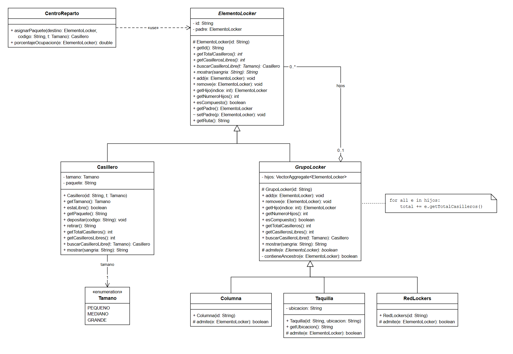
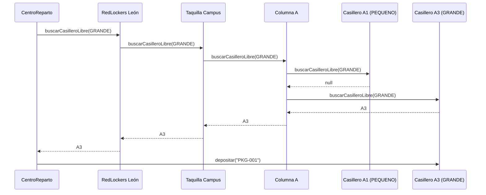
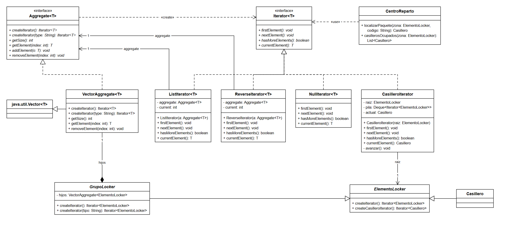
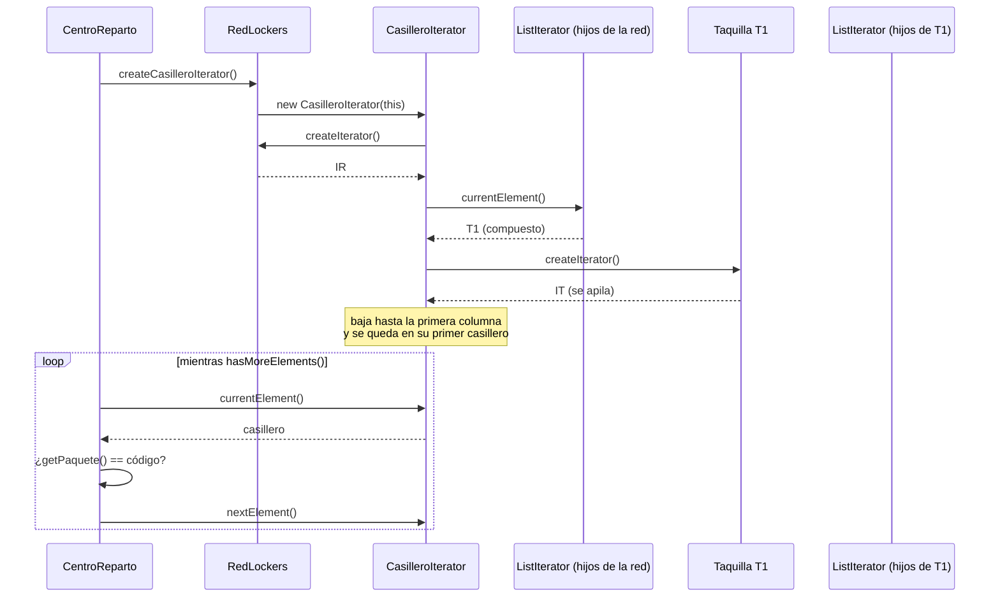
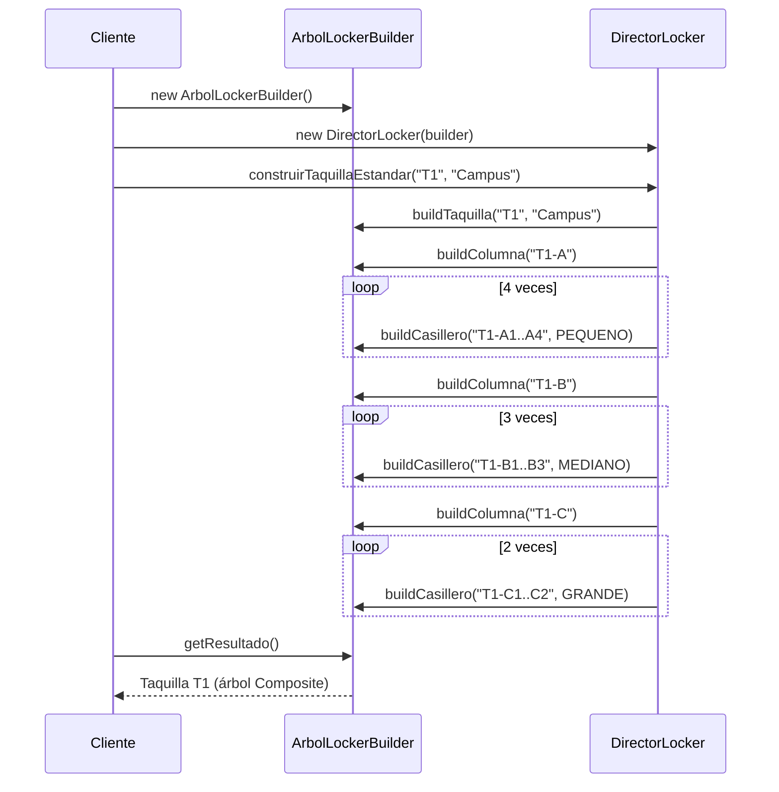
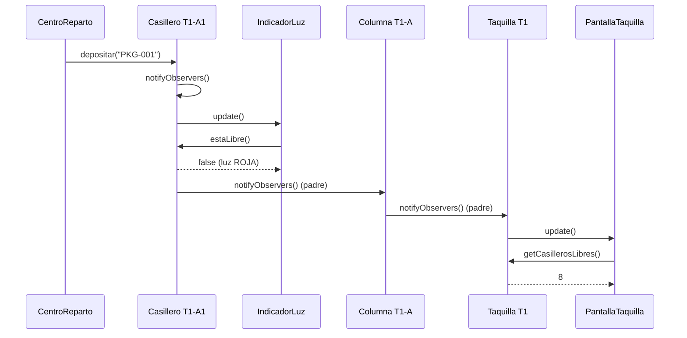

# Patrones de diseño — Amazon Locker

Programación II · Grado en Ingeniería Informática

Cada semana se aplica un patrón de diseño a la temática de los
[Amazon Locker](https://en.wikipedia.org/wiki/Amazon_Locker): taquillas de
autoservicio donde el cliente recoge su pedido tecleando un código. Cada patrón
tiene su paquete de código con tests unitarios.

| Tema | Patrón | Paquete |
|------|--------|---------|
| 4 | [Composite](#composite) | `amazonlocker.composite` |
| 5 | [Iterator](#iterator)   | `amazonlocker.iterator` |
| 7 | [Builder](#builder)     | `amazonlocker.builder` |
| 8 | [Observer](#observer)   | `amazonlocker.observer` |

```
DirectorLocker + LockerBuilder  ──construye──▶  árbol Composite (Red > Taquilla > Columna > Casillero)
                                                        │
                                  Iterator ◀──recorre───┤
                                                        │
                                  Observer ◀──avisa─────┘
```

Los diagramas de clases están en `etc/` (`.drawio`, editables con
[draw.io](https://app.diagrams.net)) y sus imágenes en `etc/images/` (`.png` y `.svg`).

---

## Composite

### Problema

Una taquilla está formada por **columnas** y cada columna por **casilleros**
(pequeño, mediano, grande). Las taquillas se agrupan en **redes** (ciudad,
región...), y una red puede contener otras redes. El centro de reparto necesita
hacer las mismas preguntas a cualquier nivel: ¿cuántos casilleros libres hay?,
¿hay alguno GRANDE libre?, ¿qué ocupación tiene esta zona?

Sin el patrón, el cliente tendría que distinguir con `instanceof` si trata con
una red, una taquilla, una columna o un casillero. Con *Composite*, casilleros y
agrupaciones comparten la interfaz `ElementoLocker` y los compuestos delegan
recursivamente en sus hijos.

### Diagrama de clases



### Roles

| Rol | Clase |
|---|---|
| **Component** | `ElementoLocker` (abstracta) |
| **Leaf** | `Casillero` |
| **Composite** | `GrupoLocker` (abstracta), con los compuestos concretos `Columna`, `Taquilla` y `RedLockers` |
| **Client** | `CentroReparto` |

### Decisiones

- **Variante transparente:** `add`, `remove` y `getHijo` se declaran en el
  Component (`ElementoLocker`), así el cliente no necesita hacer *downcasting*.
  Para no perder seguridad, en la hoja lanzan `UnsupportedOperationException`;
  `esCompuesto()` permite consultarlo sin `instanceof`.
- **Referencia al padre:** `getPadre()` y `getRuta()`
  (`Red León > T1 > T1-A > T1-A2`). La gestiona solo `GrupoLocker` al hacer
  `add`/`remove` y evita que un elemento esté en dos grupos a la vez.
- **Restricción de tipos:** cada compuesto indica en `admite()` qué hijos
  acepta (`Columna` → `Casillero`, `Taquilla` → `Columna`, `RedLockers` →
  `Taquilla` o `RedLockers`). También se impiden ciclos.

### Diagrama de secuencia: asignar un paquete

El cliente pide un casillero GRANDE a la red y la petición baja por el árbol
hasta encontrar una hoja libre.



---

## Iterator

### Problema

Hay muchas tareas que recorren el árbol del locker: buscar el casillero que
tiene un código de recogida, listar los casilleros ocupados de una zona, sumar
los libres de cada compuesto, o recorrer una columna al revés. Si el cliente
accede directamente a la lista de hijos queda acoplado a la estructura interna y
tiene que escribir bucles recursivos distintos según la profundidad.

Con *Iterator* cada colección crea su iterador y se recorre siempre con la
misma interfaz (`firstElement`, `nextElement`, `hasMoreElements`,
`currentElement`).

### Diagrama de clases



### Roles

| Rol | Clase |
|---|---|
| **Iterator** | `Iterator<T>` (interfaz) |
| **ConcreteIterator** | `ListIterator<T>`, `ReverseIterator<T>`, `NullIterator<T>` y `CasilleroIterator` |
| **Aggregate** | `Aggregate<T>` (interfaz) |
| **ConcreteAggregate** | `VectorAggregate<T>` (adapta `java.util.Vector`) |
| **Client** | `CentroReparto` y `GrupoLocker` |

### Decisiones

- **Iteradores externos:** el cliente controla el avance con `nextElement()`.
- **Varios recorridos sobre el mismo agregado:** `createIterator()` devuelve un
  `ListIterator` y `createIterator("reverse")` un `ReverseIterator`.
- **NullIterator:** lo devuelve `Casillero` (no tiene hijos), así se puede
  pedir un iterador a cualquier `ElementoLocker` sin preguntar si es hoja.
- **Iterador sobre el Composite:** `CasilleroIterator` recorre en profundidad
  todos los casilleros de un subárbol con una pila de iteradores (uno por
  nivel). Lo usa `CentroReparto.localizarPaquete()`.

### Diagrama de secuencia: localizar un paquete

El cliente teclea su código y se recorren todos los casilleros de la red con el
`CasilleroIterator`, sin conocer la forma del árbol.



---

## Builder

### Problema

Montar el árbol de un locker a mano es largo y repetitivo: una taquilla
estándar tiene 3 columnas y 9 casilleros, y una red puede tener decenas de
taquillas. Además, con la misma configuración Amazon necesita dos cosas
distintas: el **árbol de objetos** para gestionar los paquetes y el **plano de
instalación** para el técnico.

Con *Builder*, el Director conoce los modelos de taquilla y el orden de montaje
(red → taquilla → columna → casillero), y cada ConcreteBuilder decide qué
representación se genera. El mismo proceso crea dos productos distintos.

### Diagrama de clases


### Roles

| Rol | Clase |
|---|---|
| **Director** | `DirectorLocker` (modelo `MODELO_ESTANDAR`) |
| **Builder** | `LockerBuilder` (abstracta) |
| **ConcreteBuilder** | `ArbolLockerBuilder` y `PlanoLockerBuilder` |
| **Product** | árbol de `ElementoLocker` y `PlanoInstalacion` |

### Decisiones

- **Sin clase abstracta de producto:** los productos (un árbol y un plano de
  texto) no comparten interfaz, así que `getResultado()` está en cada
  ConcreteBuilder.
- **Métodos vacíos por defecto:** `PlanoLockerBuilder` no sobrescribe
  `buildRed()` porque la red no se instala físicamente.
- **Ensamblaje:** cada parte se añade a la última parte contenedora construida
  (el casillero a la última columna...). `ArbolLockerBuilder` lanza
  `IllegalStateException` si el orden no es válido.

### Diagrama de secuencia: construir una taquilla estándar



---

## Observer

### Problema

Cuando se deposita o se recoge un paquete cambia el estado del casillero y
también el de su columna, taquilla y red. Varios objetos dependen de ese estado:
la **luz de la puerta** (verde/roja), la **pantalla de la taquilla** (casilleros
libres) y la **alerta de logística** (ocupación de una red). Si el casillero los
llamase directamente quedaría acoplado a todos y habría que modificarlo cada vez
que se añade un dispositivo.

Con *Observer*, cada elemento del locker guarda una lista de observadores y les
avisa con `notifyObservers()` cuando cambia.

### Diagrama de clases


### Roles

| Rol | Clase |
|---|---|
| **Subject** | `Subject` (abstracta) |
| **ConcreteSubject** | `Casillero` (y por propagación `Columna`, `Taquilla`, `RedLockers`) |
| **Observer** | `Observer` (interfaz) |
| **ConcreteObserver** | `IndicadorLuz`, `PantallaTaquilla` y `AlertaOcupacion` |

### Decisiones

- **`ElementoLocker` hereda de `Subject`:** se puede observar cualquier nivel
  del árbol.
- **Propagación hacia arriba:** tras avisar a sus observadores, cada elemento
  avisa a su padre. Por eso la pantalla solo observa la taquilla, no sus 9
  casilleros.
- **Modelo pull:** `update()` no recibe datos; cada observador guarda una
  referencia a su sujeto y le consulta el estado.
- **Quién y cuándo notifica:** el propio sujeto, al final de `depositar()` y
  `retirar()`, cuando su estado ya es coherente. Si la operación falla no se
  notifica.

### Diagrama de secuencia: depositar un paquete

El casillero avisa a su luz y el aviso sube por el árbol hasta la taquilla,
que actualiza su pantalla.



---

## Estructura

```
pom.xml
etc/                       diagramas UML (.drawio) y sus imágenes (etc/images)
src/main/java/amazonlocker/
├── composite/             Composite (+ CasilleroIterator y CentroReparto)
├── iterator/              Iterator, Aggregate, VectorAggregate, ListIterator...
├── builder/               LockerBuilder, Director, ConcreteBuilders, PlanoInstalacion
├── observer/              Subject, Observer y observadores concretos
└── Main.java              demo de todos los patrones juntos
src/test/java/amazonlocker/   tests JUnit 5
```

## Ejecución

```bash
mvn test                                                  # tests unitarios
mvn compile exec:java -Dexec.mainClass=amazonlocker.Main  # demo
```
