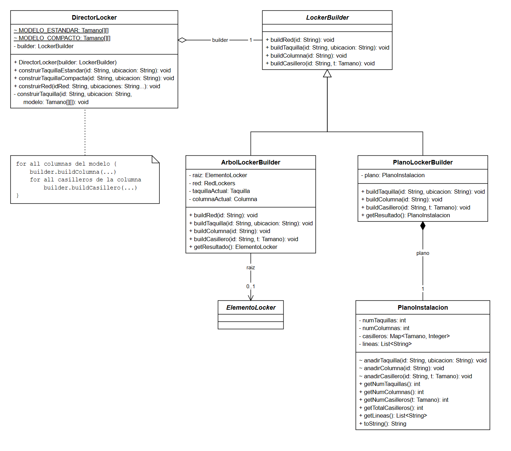
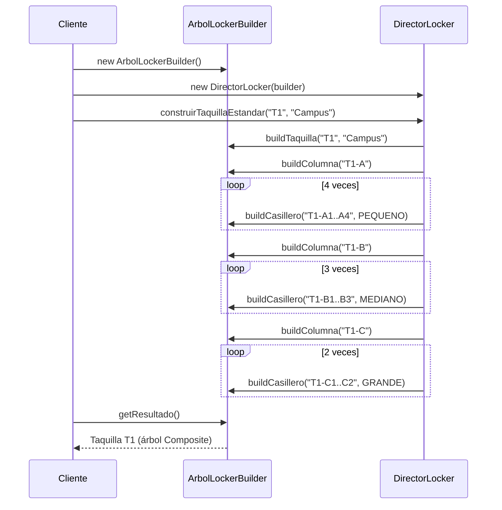

# Patrón Builder — Amazon Locker

## 1. El problema

Montar el árbol Composite de un Amazon Locker a mano es largo y propenso a
errores: una taquilla estándar tiene 3 columnas y 9 casilleros, y una red de
la ciudad puede tener decenas de taquillas. Sin el patrón, el código cliente
estaría lleno de `new Casillero(...)`, `columna.add(...)`, `taquilla.add(...)`
repetidos, y cualquier cambio en el modelo de taquilla obligaría a tocarlo en
todas partes.

Además, Amazon no solo necesita **el árbol de objetos** para gestionar los
paquetes: con la **misma** configuración necesita también el **plano de
instalación** que recibe el técnico (qué taquillas montar, dónde, y cuántas
piezas de cada tamaño pedir).

**Solución:** con el patrón *Builder*:

- El **Director** (`DirectorLocker`) conoce los modelos de taquilla (estándar,
  compacta) y el **orden** en que se montan sus partes: red → taquilla →
  columna → casillero.
- Cada **ConcreteBuilder** decide **qué representación** se genera con esas
  partes:
  - `ArbolLockerBuilder` → el árbol Composite (`RedLockers`, `Taquilla`,
    `Columna`, `Casillero`).
  - `PlanoLockerBuilder` → un `PlanoInstalacion` en texto con el recuento de
    material.

El mismo proceso de construcción crea dos representaciones distintas.

## 2. Diagrama UML de clases

El fuente editable está en [`etc/builder.drawio`](../etc/builder.drawio) (se abre con [draw.io](https://app.diagrams.net)); también hay una versión vectorial en [`etc/images/builder.svg`](../etc/images/builder.svg).

Dentro de `construirTaquilla`, el Director recorre el modelo: por cada columna
llama a `buildColumna()` y, por cada casillero de esa columna, a
`buildCasillero()`.

## 3. Roles del patrón y clases que los desempeñan

| Rol | Clase | Responsabilidad |
|---|---|---|
| **Builder** | `LockerBuilder` (abstracta) | Interfaz para crear las partes de un locker: `buildRed`, `buildTaquilla`, `buildColumna`, `buildCasillero`. |
| **ConcreteBuilder** | `ArbolLockerBuilder` | Crea y combina los objetos del Composite. Guarda la taquilla y la columna actuales para saber dónde colgar cada parte. Ofrece `getResultado()`. |
| | `PlanoLockerBuilder` | Va escribiendo el plano de instalación y contando piezas. Ofrece `getResultado()`. |
| **Director** | `DirectorLocker` | Construye taquillas y redes usando solo la interfaz `LockerBuilder`. Contiene los modelos `MODELO_ESTANDAR` y `MODELO_COMPACTO`. |
| **Product** | `ElementoLocker` (árbol Composite) | Primera representación. |
| | `PlanoInstalacion` | Segunda representación. |
| **Cliente** | `Main` / tests | Crea el ConcreteBuilder, se lo pasa al Director, llama a `construir...()` y pide el resultado al builder. |

## 4. Decisiones de implementación

- **Interfaz de construcción y ensamblaje:** cada `buildX` añade la parte a la
  **última parte contenedora** construida (la taquilla a la red, la columna a la
  última taquilla, el casillero a la última columna). Así el Director no tiene
  que manejar referencias a las partes. `ArbolLockerBuilder` lanza
  `IllegalStateException` si el orden no es válido (p. ej. un casillero sin
  columna).
- **¿Por qué no hay una clase abstracta del producto?** Porque los productos
  son completamente distintos (un árbol de objetos y un plano de texto) y no
  comparten interfaz. Por eso `getResultado()` está en cada ConcreteBuilder y no
  en `LockerBuilder`, y el cliente pide el resultado al builder concreto.
- **Métodos vacíos por defecto en Builder:** `LockerBuilder` es una clase
  abstracta con todos los métodos vacíos. `PlanoLockerBuilder` no sobrescribe
  `buildRed()` porque la red es un concepto lógico que no se instala.
- **Identificadores:** el Director los genera siguiendo la posición física:
  taquillas `T1, T2…`, columnas `T1-A, T1-B…`, casilleros `T1-A1, T1-A2…`.

## 5. Diagrama de secuencia — construir una taquilla estándar

## 6. Código

| Fichero | Rol |
|---|---|
| `builder/LockerBuilder.java` | Builder |
| `builder/ArbolLockerBuilder.java` | ConcreteBuilder (árbol Composite) |
| `builder/PlanoLockerBuilder.java` | ConcreteBuilder (plano de instalación) |
| `builder/DirectorLocker.java` | Director |
| `builder/PlanoInstalacion.java` | Product |

Tests: `builder/BuilderTest`.
