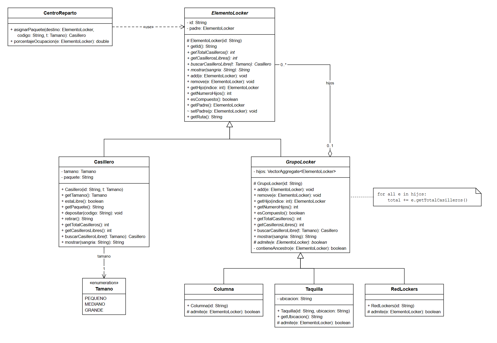
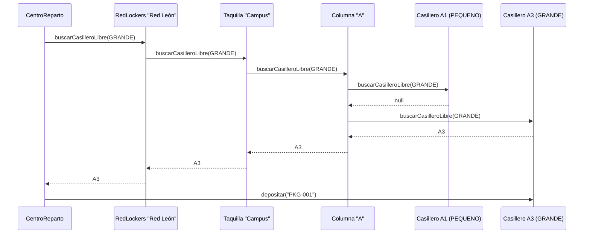

# Patrón Composite — Amazon Locker

## 1. El problema

Un **Amazon Locker** es un quiosco de autoservicio donde los clientes recogen sus
pedidos introduciendo un código. Físicamente, una taquilla está formada por
**columnas**, y cada columna por **casilleros** de distintos tamaños (pequeño,
mediano, grande). A su vez, Amazon gestiona muchas taquillas agrupadas en
**redes** (ciudad, región, país...), y una red puede contener otras redes.

```
Red España
├── Red León
│   ├── Taquilla Campus
│   │   ├── Columna A ── A1, A2, A3
│   │   └── Columna B ── B1, B2
│   └── Taquilla Estación
│       └── Columna C ── C1
└── Taquilla Madrid ...
```

El centro de reparto necesita hacer las mismas preguntas a **cualquier nivel**
de esa jerarquía:

- ¿Cuántos casilleros hay en total? ¿Cuántos libres?
- ¿Hay algún casillero libre de tamaño GRANDE? Si lo hay, deposita el paquete.
- ¿Qué porcentaje de ocupación tiene esta zona / taquilla / columna?

Sin el patrón, el código cliente tendría que distinguir con `if/instanceof` si
está tratando con una red, una taquilla, una columna o un casillero, y recorrer
cada nivel con bucles anidados distintos. Añadir un nuevo nivel (p. ej.
*Región*) obligaría a modificar todo ese código.

**Solución:** con el patrón *Composite* se construye una estructura en árbol
donde casilleros (hojas) y agrupaciones (compuestos) comparten la misma
interfaz `ElementoLocker`. El cliente llama a `getCasillerosLibres()` o
`buscarCasilleroLibre(tamano)` sobre cualquier nodo, y los compuestos delegan
recursivamente en sus hijos.

## 2. Diagrama UML de clases



El fuente editable está en [`etc/composite.drawio`](../etc/composite.drawio) (se abre con [draw.io](https://app.diagrams.net)); también hay una versión vectorial en [`etc/images/composite.svg`](../etc/images/composite.svg).

## 3. Roles del patrón y clases que los desempeñan

| Rol           | Clase                                  | Responsabilidad en el ejemplo |
|---------------|----------------------------------------|-------------------------------|
| **Componente**| `ElementoLocker` (abstracta)           | Declara la interfaz común (`getTotalCasilleros`, `getCasillerosLibres`, `buscarCasilleroLibre`, `mostrar`) y la de manejo de hijos (`add`, `remove`, `getHijo`). Incluye la referencia opcional al **padre** (`getPadre`, `getRuta`). |
| **Hoja**      | `Casillero`                            | No tiene hijos. Define el comportamiento primitivo: está libre u ocupado, se deposita y se retira un paquete. |
| **Compuesto** | `GrupoLocker` (abstracta)              | Almacena los hijos en un `VectorAggregate<ElementoLocker>`, implementa `add/remove/getHijo` y las operaciones comunes delegando recursivamente en los hijos. |
| Compuestos concretos | `Columna`, `Taquilla`, `RedLockers` | Restringen dinámicamente qué hijos admiten (`admite`). |
| **Cliente**   | `CentroReparto` (y `Main`)             | Trabaja solo con `ElementoLocker`: asigna paquetes y calcula ocupación sin saber si recibe un casillero o una red entera. |

## 4. Decisiones de implementación

- **¿Dónde se declaran las operaciones de los hijos?** En el Componente
  (`ElementoLocker`) → **transparencia**: el cliente no necesita hacer
  *downcasting*. Para no perder seguridad, la implementación por defecto lanza
  `UnsupportedOperationException`, de modo que una hoja (`Casillero`) nunca
  acepta hijos. `esCompuesto()` permite consultarlo sin `instanceof`.
- **Referencia al padre:** se guarda en `ElementoLocker` y solo la modifica
  `GrupoLocker` al hacer `add/remove` (el *setter* es de paquete). Permite
  obtener la ruta de un casillero (`Red León > Taquilla Campus > Columna A > A2`)
  y evita que un elemento esté en dos grupos a la vez.
- **¿Debe el Componente declarar la lista de hijos?** No; la lista está en
  `GrupoLocker`, para que las hojas no carguen con un atributo que no usan.
- **Estructura de datos:** un `VectorAggregate` (patrón Iterator, ver
  [iterator.md](iterator.md)), porque el orden importa (posición del casillero
  en la columna), `getHijo(int)` es de acceso directo y los hijos se recorren
  con un iterador sin exponer la colección.
- **Construcción del árbol:** en lugar de crear a mano cada casillero y
  columna, se usa el patrón Builder (ver [builder.md](builder.md)).
- **Restricción de tipos (desventaja del patrón):** se resuelve con
  comprobaciones dinámicas en `admite()`: una `Columna` solo admite
  `Casillero`, una `Taquilla` solo `Columna`, y una `RedLockers` admite
  `Taquilla` u otra `RedLockers`. También se impiden ciclos.
- **Avisos de cambios:** `ElementoLocker` hereda de `Subject` (patrón
  Observer, ver [observer.md](observer.md)). Cuando un casillero cambia, el
  aviso sube por la referencia al padre hasta la red.
- **Eliminación:** `remove` desvincula al hijo (pone su padre a `null`); en
  Java el recolector de basura se encarga de liberar la memoria.

## 5. Diagrama de secuencia — asignar un paquete



## 6. Código

Paquete `src/main/java/amazonlocker/composite/`:

| Fichero | Rol |
|---|---|
| `ElementoLocker.java` | Componente |
| `Casillero.java` | Hoja |
| `GrupoLocker.java` | Compuesto |
| `Columna.java`, `Taquilla.java`, `RedLockers.java` | Compuestos concretos |
| `Tamano.java` | Enumerado de tamaños |
| `CentroReparto.java` | Cliente |

Tests en `src/test/java/amazonlocker/composite/`: `CasilleroTest`,
`GrupoLockerTest` y `CentroRepartoTest`.
