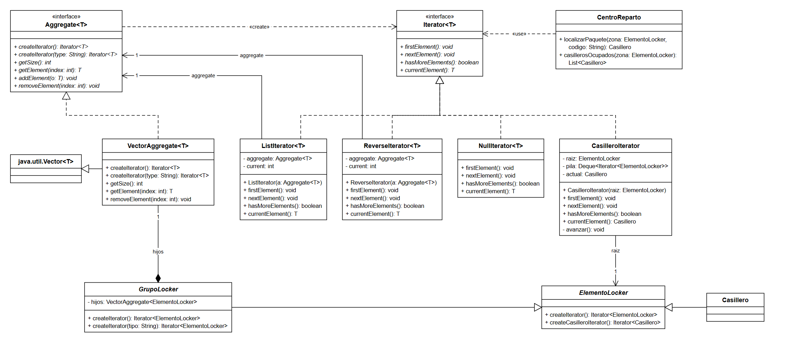
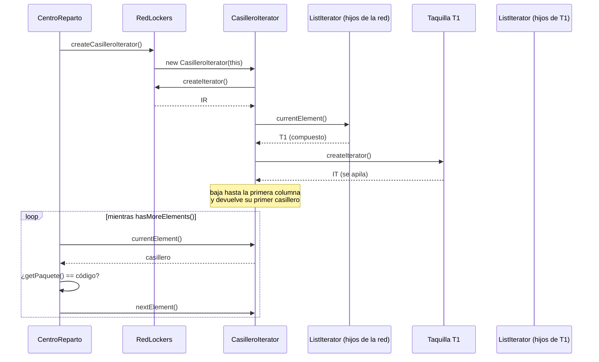

# Patrón Iterator — Amazon Locker

## 1. El problema

El árbol del Amazon Locker (ver [composite.md](composite.md)) guarda los hijos
de cada red, taquilla y columna en una colección interna. Hay varias tareas que
necesitan **recorrer** esos elementos:

- Cuando el cliente teclea su código de recogida en la pantalla del locker, hay
  que encontrar **el casillero que tiene ese paquete**, esté en la columna y la
  taquilla que esté.
- El repartidor necesita la **lista de casilleros ocupados** de una zona para
  retirar los paquetes que llevan demasiado tiempo sin recogerse.
- Los compuestos necesitan recorrer sus hijos para sumar casilleros libres,
  buscar huecos, etc.
- A veces interesa otro orden (p. ej. revisar una columna **de abajo a arriba**).

Si el cliente accede directamente a la lista de hijos, queda acoplado a la
estructura interna (`ArrayList`, `Vector`...) y tiene que escribir bucles
recursivos distintos según la profundidad del árbol.

**Solución:** con el patrón *Iterator* cada colección crea su propio iterador
(`createIterator()`), y el cliente la recorre siempre con la misma interfaz
(`firstElement`, `nextElement`, `hasMoreElements`, `currentElement`), sin
conocer cómo están guardados los elementos. Además se añade un iterador en
profundidad (`CasilleroIterator`) que usa el iterador **como cursor sobre el
Composite** y devuelve todos los casilleros de cualquier subárbol.

## 2. Diagrama UML de clases



El fuente editable está en [`etc/iterator.drawio`](../etc/iterator.drawio) (se abre con [draw.io](https://app.diagrams.net)); también hay una versión vectorial en [`etc/images/iterator.svg`](../etc/images/iterator.svg).

## 3. Roles del patrón y clases que los desempeñan

| Rol | Clase | Responsabilidad |
|---|---|---|
| **Iterator** | `Iterator<T>` | Interfaz para acceder y recorrer los elementos de un agregado. |
| **ConcreteIterator** | `ListIterator<T>` | Recorre del primero al último y guarda la posición actual. |
| | `ReverseIterator<T>` | Recorre del último al primero (otra forma de recorrer el mismo agregado). |
| | `NullIterator<T>` | Iterador vacío que devuelven las hojas (`Casillero`). |
| | `CasilleroIterator` | Recorre en profundidad todos los casilleros de un subárbol del Composite. |
| **Aggregate** | `Aggregate<T>` | Interfaz para crear iteradores y manejar los elementos. |
| **ConcreteAggregate** | `VectorAggregate<T>` | Adapta `java.util.Vector` y crea el iterador adecuado (`"list"` o `"reverse"`). |
| | `ElementoLocker` / `GrupoLocker` | Cada elemento del locker crea iteradores sobre sus hijos (`createIterator`) y sobre sus casilleros (`createCasilleroIterator`). |
| **Cliente** | `CentroReparto`, `GrupoLocker` | Recorren los elementos solo a través de la interfaz `Iterator`. |

## 4. Decisiones de implementación

- **¿Quién controla la iteración?** Se usan **iteradores externos**: el
  cliente avanza con `nextElement()` y decide qué hace con cada elemento.
  ```java
  Iterator<Casillero> it = zona.createCasilleroIterator();
  for (it.firstElement(); it.hasMoreElements(); it.nextElement()) { ... }
  ```
- **¿Quién define el algoritmo de recorrido?** El **iterador**. Así se pueden
  usar varios iteradores a la vez sobre la misma colección (hay un test que lo
  comprueba) y reutilizarlos.
- **¿Es posible usar un iterador como cursor en un Composite?** Sí:
  `CasilleroIterator` guarda una **pila de iteradores**, uno por nivel. Cuando
  encuentra un compuesto baja un nivel (apila su iterador) y cuando un nivel se
  acaba lo desapila. Funciona igual desde una red, una taquilla, una columna o
  un casillero suelto, y se salta los grupos vacíos.
- **¿Para qué sirve un NullIterator?** Un `Casillero` no tiene hijos;
  `createIterator()` devuelve un `NullIterator` (que no tiene elementos), así el
  cliente puede pedir un iterador a cualquier `ElementoLocker` sin preguntar
  antes si es hoja o compuesto.
- **Relación agregado–iterador:** el agregado crea el iterador pasándose a sí
  mismo (`new ListIterator<>(this)`), y el iterador solo usa `getSize()` y
  `getElement(int)`, nunca la estructura interna.
- **¿Se puede modificar la estructura mientras se recorre?** No es seguro: los
  iteradores no hacen copia de la colección. Si se añaden o eliminan hijos
  durante el recorrido, hay que reiniciarlo con `firstElement()`.

## 5. Diagrama de secuencia — localizar un paquete



## 6. Código

| Fichero | Rol |
|---|---|
| `iterator/Iterator.java` | Iterator |
| `iterator/Aggregate.java` | Aggregate |
| `iterator/VectorAggregate.java` | ConcreteAggregate |
| `iterator/ListIterator.java`, `iterator/ReverseIterator.java`, `iterator/NullIterator.java` | ConcreteIterator |
| `composite/CasilleroIterator.java` | ConcreteIterator sobre el Composite |
| `composite/CentroReparto.java` | Cliente (`localizarPaquete`, `casillerosOcupados`) |

Tests: `iterator/VectorAggregateTest`, `composite/CasilleroIteratorTest` y
`composite/CentroRepartoTest`.
