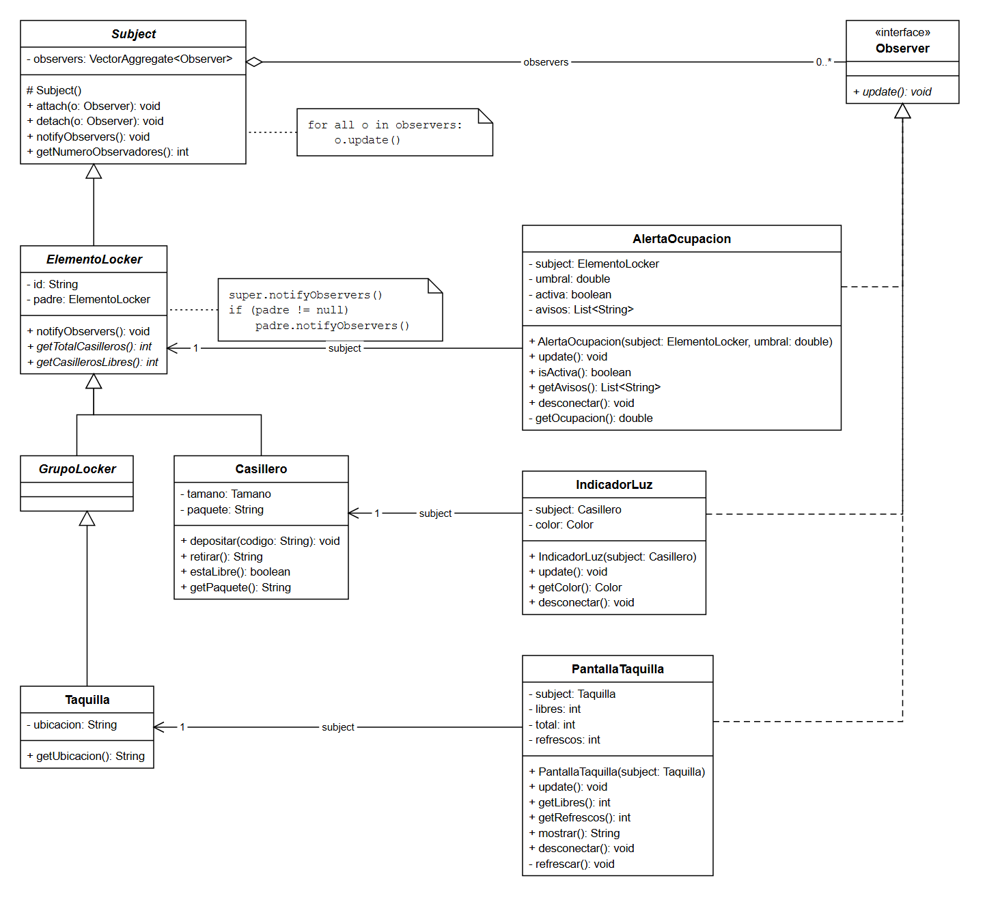
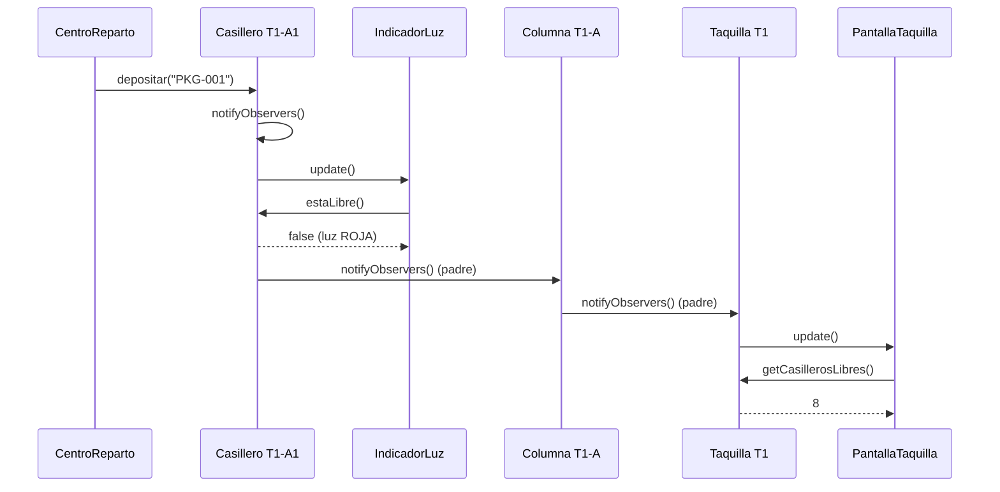

# Patrón Observer — Amazon Locker

## 1. El problema

Cuando el repartidor deposita un paquete en un casillero (o el cliente lo
recoge), cambia el estado del casillero y también el de su columna, su taquilla
y su red (tienen un casillero libre menos). Hay **varios objetos** que dependen
de ese estado y tienen que actualizarse solos:

- La **luz de la puerta** del casillero: verde si está libre, roja si tiene
  un paquete.
- La **pantalla táctil de la taquilla**, que muestra cuántos casilleros quedan
  libres (o "COMPLETA").
- La **alerta de logística** de una red, que avisa cuando la ocupación supera
  un umbral para redirigir los envíos a otra zona.

Si `Casillero.depositar()` llamase directamente a cada uno de estos objetos, el
casillero quedaría **acoplado** a todos ellos y, cada vez que Amazon añadiese
un nuevo dispositivo, habría que modificar `Casillero`. Además, el casillero ni
siquiera sabe cuántos objetos dependen de él.

Es decir, un cambio en un objeto exige cambios en otros, sin saber cuántos
ni de qué clase son.

**Solución:** con el patrón *Observer*, cada elemento del locker es un
`Subject` que guarda una lista de `Observer`. Cuando el estado cambia se llama a
`notifyObservers()`, y cada observador consulta a su sujeto lo que necesita
(modelo *pull*).

## 2. Diagrama UML de clases

El fuente editable está en [`etc/observer.drawio`](../etc/observer.drawio) (se abre con [draw.io](https://app.diagrams.net)); también hay una versión vectorial en [`etc/images/observer.svg`](../etc/images/observer.svg).

`notifyObservers()` hace `for all o in observers: o.update()`. En
`ElementoLocker`, además, avisa después a su padre (`padre.notifyObservers()`).

## 3. Roles del patrón y clases que los desempeñan

| Rol | Clase | Responsabilidad |
|---|---|---|
| **Subject** | `Subject` (abstracta) | Conoce a sus observadores (de 0 a N) y permite añadirlos (`attach`) y eliminarlos (`detach`). |
| **Observer** | `Observer` (interfaz) | Define `update()`, con el que se notifican los cambios del Subject. |
| **ConcreteSubject** | `Casillero` | Almacena el estado que interesa (`paquete`, libre/ocupado) y llama a `notifyObservers()` al depositar o retirar. |
| | `Taquilla`, `RedLockers`, `Columna` | Su estado (casilleros libres) cambia cuando cambia un casillero hijo; reciben el aviso por propagación. |
| **ConcreteObserver** | `IndicadorLuz` | Referencia a un `Casillero`. Estado: `color` (VERDE/ROJO). |
| | `PantallaTaquilla` | Referencia a una `Taquilla`. Estado: `libres`. |
| | `AlertaOcupacion` | Referencia a cualquier `ElementoLocker` (normalmente una red). Estado: `activa`. |

Cada ConcreteObserver:

- recibe su sujeto en el constructor;
- se suscribe con `subject.attach(this)`;
- en `update()` le pide el estado para mantener los dos estados consistentes.

## 4. Decisiones de implementación

- **¿Dónde está el Subject?** `ElementoLocker` (el Componente del Composite)
  hereda de `Subject`, así **cualquier nivel del árbol se puede observar**: un
  casillero, una columna, una taquilla o una red entera.
- **¿Puede un observador observar a más de un sujeto?** Con `update()` sin
  parámetros, el observador no sabría cuál de ellos ha cambiado. Por eso cada
  observador tiene **un único sujeto**. Para vigilar una taquilla entera no hace
  falta suscribirse a sus 9 casilleros: basta con observar la taquilla, gracias a
  la propagación (siguiente punto). `java.util.Observer` lo resuelve pasando el
  sujeto en `update(Observable o, Object arg)`.
- **¿Quién hace la llamada a `update`?** **El sujeto**: `depositar()` y
  `retirar()` llaman a `notifyObservers()`, así el cliente (`CentroReparto`) no
  puede "olvidarse". Después, `ElementoLocker.notifyObservers()` avisa también a
  los observadores del padre, de modo que el cambio sube por el Composite:
  casillero → columna → taquilla → red. Se hace una notificación por nivel, y
  solo a los observadores de ese nivel.
- **¿En qué momento se notifican los cambios?** Al **final** de la operación,
  cuando el estado del sujeto ya es coherente. Si la operación falla (casillero
  ocupado, código vacío...) se lanza la excepción antes y no se notifica nada.
- **¿Qué implica la eliminación de un subject?** Al quitar un casillero de su
  columna (`remove`), su padre pasa a `null` y deja de propagar el cambio hacia
  arriba. No se eliminan los observadores, porque podrían estar observando
  otros sujetos. Cada observador ofrece `desconectar()` (que hace
  `subject.detach(this)`) para darse de baja.
- **Push o pull:** se usa el modelo **pull**: `update()`
  solo avisa y el observador pregunta (`estaLibre()`, `getCasillerosLibres()`).
  Su desventaja (el aviso no dice qué ha cambiado) se ve en `AlertaOcupacion`: tiene que guardar si ya estaba
  `activa` para avisar solo cuando se **cruza** el umbral y no en cada cambio.
- **Darse de baja durante la notificación:** `notifyObservers()` recorre una
  copia de la lista, así un observador puede hacer `detach` en su propio
  `update()` sin que se salte al siguiente.
- **Colección de observadores:** un `VectorAggregate` (un `Vector`)
  recorrido con el `Iterator` del proyecto. `attach` no admite `null`
  ni duplicados.
- **Posible mejora (suscripción a aspectos de interés):** la pantalla solo
  necesita los cambios de libres/ocupados y la luz solo los de su casillero. Si
  hubiera más tipos de cambio (avería, puerta abierta...), cada observador
  podría suscribirse solo a los aspectos que le interesan.

## 5. Diagrama de secuencia — depositar un paquete

## 6. Código

| Fichero | Rol |
|---|---|
| `observer/Subject.java` | Subject |
| `observer/Observer.java` | Observer |
| `composite/ElementoLocker.java` | Hereda de Subject y propaga la notificación al padre |
| `composite/Casillero.java` | ConcreteSubject (llama a `notifyObservers()`) |
| `observer/IndicadorLuz.java`, `observer/PantallaTaquilla.java`, `observer/AlertaOcupacion.java` | ConcreteObserver |

Tests: `observer/ObserverTest`.
